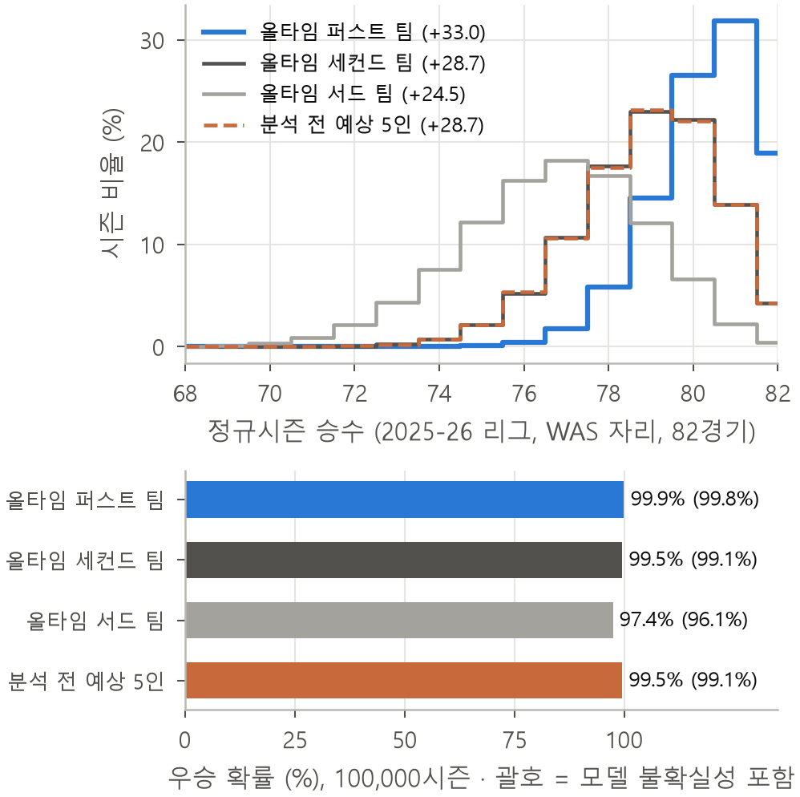
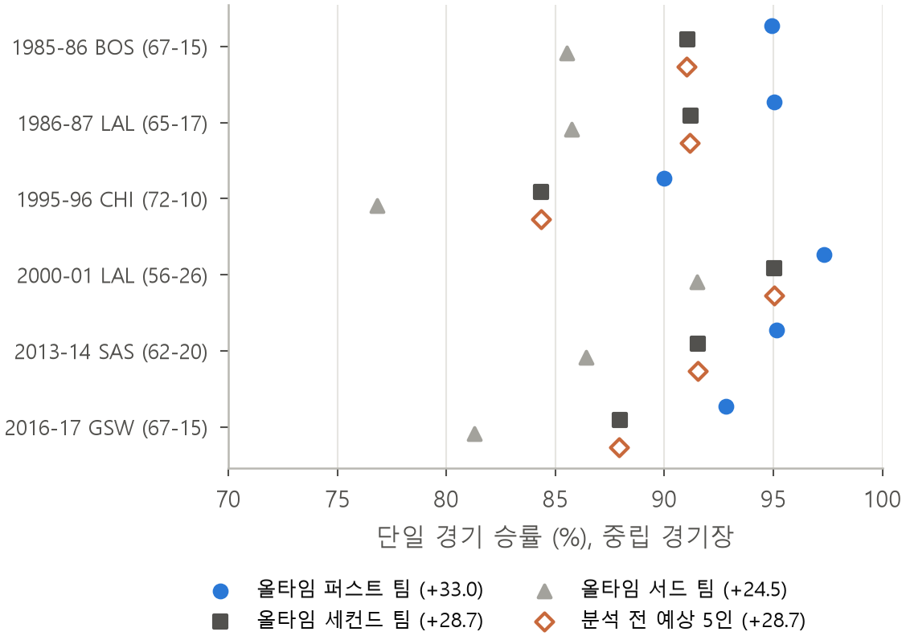

# nba_alltime_team
과제 제출물: Selecting the NBA’s All-Time Best Five Using Statistical Modeling and Monte Carlo Simulation

Midterm project for 농구초급 (Seoul National University, 2026): combine your major with basketball.

**Paper:** [`paper.pdf`](paper.pdf) (Korean, IEEE two-column, 6 pages). LaTeX source in [`paper/`](paper/).

**Question:** among players from 1979-80 (the first 3-point season) to 2025-26, each taken at his 3-season prime,
which two guards, two forwards and one center make the strongest team, and how would that team do against the
2025-26 NBA and the great dynasties?

## Results

| Team | Players (G, G, F, F, C) | Net rating | Avg. wins (of 82) | 82-0 seasons | Title odds |
|---|---|---|---|---|---|
| First | Chris Paul, Michael Jordan, LeBron James, Giannis Antetokounmpo, Nikola Jokić | +33.0 | 80.4 | 18.9% | 99.9% |
| Second | Shai Gilgeous-Alexander, Magic Johnson, Kevin Durant, Jimmy Butler, David Robinson | +28.7 | 78.9 | 4.2% | 99.5% |
| Third | John Stockton, Manu Ginóbili, Kawhi Leonard, Kevin Garnett, Anthony Davis | +24.5 | 76.7 | 0.4% | 97.4% |

Each team replaces the 2025-26 Washington Wizards and plays the full season, play-in and playoffs, 100,000 times.
The best real team since 1979-80, the 1995-96 Bulls, rates +13.4.




## Method

1. **Data:** 683 Basketball-Reference pages → 25,349 player-seasons, 1,314 team-seasons, 52,848 games.
2. **Player metric:** Box Plus/Minus (BPM), chosen because it predicted next-season team net rating best in
   leave-one-season-out tests (RMSE: BPM 3.00, WS/48 3.25, PER 3.44, last-season baseline 3.72, box-score sum 3.81).
3. **Prime:** best three consecutive qualifying seasons (1,500+ minutes, scaled for short seasons), minutes-weighted.
4. **Team model (one-ball usage):** the five players' usage rates are rescaled to sum to 100%, and each player's
   offensive efficiency rises by k per percentage point of usage given up. k = 0.28, estimated from 8,353
   same-player season pairs (bootstrap 90% interval 0.24–0.33). Defense is the sum of DBPM.
5. **Search:** every G-G-F-F-C five from the top 60 primes (976,952 lineups). The best five is the First Team;
   remove them and search again for the Second and Third Teams.
6. **Monte Carlo:** game margin ~ Normal(home court 1.74 + rating difference, σ = 14.05), fitted on real games
   (Brier score 0.208 on held-out seasons, vs. 0.25 for a coin flip).

## Run

Open each file in VS Code and press ▶ Run Python File, in order:

1. `00_setup.py` — creates `.venv` in this folder and installs `requirements.txt` (Python 3.10+)
2. `01_download.py` — downloads ~683 pages, ~45 min, resumable (4 s between requests)
3. `run_all.py` — steps 02–11 (a few minutes)
4. `13_all_time_teams.py` — All-Time First/Second/Third Teams and their simulations
5. `12_single_season.py` (optional) — the same search using single best seasons instead of 3-season primes

From a terminal on Windows:

```powershell
py -3 00_setup.py
.\.venv\Scripts\python.exe 01_download.py
.\.venv\Scripts\python.exe run_all.py
.\.venv\Scripts\python.exe 13_all_time_teams.py
```

On macOS/Linux: `python3 00_setup.py`, then `python3 01_download.py`, `python3 run_all.py`, `python3 13_all_time_teams.py`.

## Scripts

| Script | What it does |
|---|---|
| `01_download.py` | Downloads Basketball-Reference pages into `data/raw/` |
| `02_parse.py` | Builds `data/player_seasons.csv`, `data/team_seasons.csv`, `data/games.csv` |
| `03_primes.py` | 3-season primes, top-15 figure and table |
| `04_metric_test.py` | Metric accuracy: predicting next season's team net rating |
| `05_metric_awards.py` | Metric agreement with MVP and All-NBA First Team voting |
| `06_case_jordan.py` | Case study: Michael Jordan, 1987-88 to 1989-90 |
| `07_team_model.py` | Team models and cross-validation; estimates k |
| `08_calibrate.py` | Game simulator calibration (home court, σ, Brier score) |
| `09_search.py` | Exhaustive G-G-F-F-C lineup search |
| `10_simulate.py` | Monte Carlo: dynasty matchups and the 2025-26 league |
| `11_paper_assets.py` | LaTeX tables and numbers for the paper |
| `12_single_season.py` | Variant: single best season instead of 3-season prime |
| `13_all_time_teams.py` | All-Time First/Second/Third Teams, head-to-head and league simulations |
| `config.py` | Settings: seasons, minutes threshold, simulation count, dynasties |
| `common.py`, `lineups.py`, `teammodel.py` | Shared helpers: data loading, position slots, team rating |

## Outputs

`figures/` holds the generated charts. `data/` and `results/` are generated by the scripts and are not in this
repository.

`paper/` is the submitted paper as edited on Overleaf (compile `main.tex` with XeLaTeX). `11_paper_assets.py` and
`13_all_time_teams.py` write `paper/numbers.tex`, `paper/numbers_teams.tex`, `paper/tables/` and `paper/figures/`, so
re-running them overwrites the submitted versions of those files.

## Data

Basketball-Reference (https://www.basketball-reference.com). Raw pages and parsed tables are not redistributed;
run `01_download.py` and `02_parse.py` to rebuild them. The downloader waits 4 s between requests to stay under the
site's limit of 20 requests per minute.
